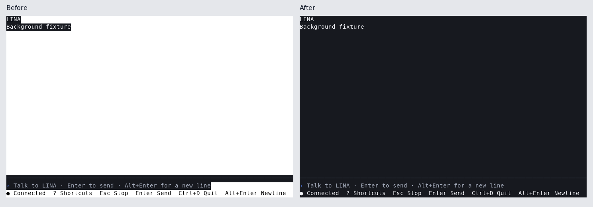

# Terminal canvas

These captures render cells recorded from the Bubble Tea output writer at 80×24,
with the default dark theme and truecolor output. Unstyled cells are shown on a
white terminal background. All text is synthetic. The left capture is before
the fix; the right capture includes the filled canvas and nested style resets.
These are renderer captures, not screenshots of a particular terminal app.

`TestShellBackgroundCoversEmptyAndTextRows` checks every cell across 16-colour,
256-colour and truecolor output, theme overrides, connection states and resize.
`TestM1TUIBackgroundInstalledCore` checks the installed Core and TUI through a
real PTY with xterm and truecolor settings, without a `COLORFGBG` hint. It checks
both the empty composer and a typed draft, then verifies terminal restoration.
